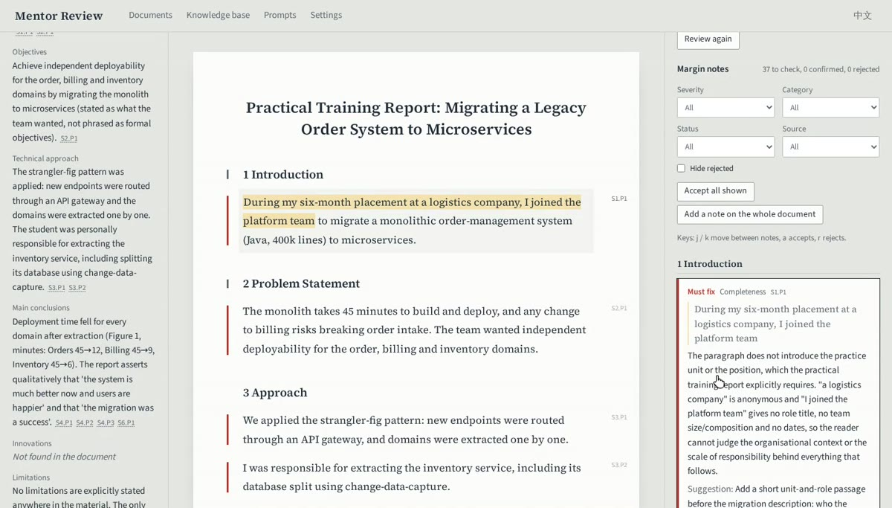

# Industry Mentor Review Assistant · 行业导师大模型智能体

A review assistant for **industry mentors of professional master's students**. The mentor uploads a
student's practice report, project proposal or technical document. The assistant reads it and
drafts the review; the mentor only confirms, edits, rejects or adds comments, then sends the
feedback back as a Word file.

Built with **LangChain** + an LLM of your choice, **FastAPI**, **Chroma**, **SQLite** and a
**React + TypeScript** interface.

## Demo

[](assets/demo.mp4)

**[▶ Watch the demo (1 min 49 s)](assets/demo.mp4)**: connecting a model in
Settings, uploading a report with a chart, the structured summary, accepting / rewriting /
rejecting margin notes, adding a note on selected text, the chart as the vision model read it,
overall feedback, the Word download, prompt editing and the knowledge base.

## What it does

| Feature | What the mentor gets |
|---|---|
| **Structured summary** | Research problem, objectives, technical approach, main conclusions, innovations, limitations and an outline. Every point links to the paragraphs it came from; anything the student did not write says *Not found* instead of being invented. |
| **Checks against your standards (RAG)** | A knowledge base of review rubrics, training-programme requirements and exemplary past work. Each section is checked against the passages that apply to it, plus rule-based format checks (heading numbering, citations, figure captions, required sections). |
| **Paragraph-anchored comments** | Margin notes tied to an exact paragraph (`S3.P2`) and quote, each with the problem, a suggestion, revision steps and the standard it relies on. Accept, edit, reject or add your own; keyboard `j` / `k` / `a` / `r`. |
| **Figures** | Charts, diagrams and screenshots in DOCX/PDF are sent to a vision model; native Word charts are read from their data. Nothing is silently dropped. |
| **Overall feedback** | Drafted from the notes you confirmed, then edited by you. |
| **Export** | Word: your notes become real comments inside the student's own `.docx`. Or Markdown. |
| **Editable prompts** | Every prompt is editable and versioned in the app. The output format is enforced in code, so an edit cannot break a review; removing a required placeholder is refused. |
| **Settings in the app** | Provider, model and API key for the language model, the vision model and the embeddings, with a *Test connection* button. No config file needed. |

The interface is in English and Chinese.

## Quick start

You need **[uv](https://docs.astral.sh/uv/getting-started/installation/)** (it installs Python 3.11
for you) and **Node.js 20+**.

**1. Start the backend** (terminal 1)

```bash
cd backend
uv sync
uv run uvicorn app.main:app --port 8000
```

**2. Start the interface** (terminal 2)

```bash
cd frontend
npm install
npm run dev
```

**3. Connect a model.** Open **http://localhost:5173**, go to **Settings**, pick your service under
*Start from*, paste the API key and press **Test connection**. You should see *Connected.*

That's it. Upload a document on **Documents** and press **Start review**.

> **Optional:** to check work against your own standards, set up *Knowledge base* embeddings in
> Settings, then add your rubric / programme requirements / exemplars on the **Knowledge base**
> page.

## Choosing a model

Pick a service under **Settings → Start from**; it fills in the provider and address.

| Service | Provider | Address | Example model |
|---|---|---|---|
| DeepSeek | OpenAI-compatible | `https://api.deepseek.com` | `deepseek-chat` |
| Qwen (DashScope) | OpenAI-compatible | `https://dashscope.aliyuncs.com/compatible-mode/v1` | `qwen-plus` (vision: `qwen-vl-max`) |
| Ollama Cloud | OpenAI-compatible | `https://ollama.com/v1` | any cloud model |
| Ollama (this computer) | OpenAI-compatible | `http://localhost:11434/v1` | `qwen2.5:14b` (vision: `qwen2.5vl`) |
| OpenAI | OpenAI-compatible | *(empty)* | `gpt-4o-mini` |
| OpenRouter | OpenRouter | *(filled in)* | `deepseek/deepseek-chat` |
| Groq | Groq | *(filled in)* | `llama-3.3-70b-versatile` |
| Claude | Anthropic | *(filled in)* | `claude-sonnet-5-5` |

- **Figures:** text-only models (e.g. `deepseek-chat`) can't see images. Set a vision model under
  *Figures*; it reuses the language model's address and key unless you give its own. Leave it
  empty to skip images (captions and chart data are still used).
- **Knowledge base embeddings** are separate because OpenRouter, Groq and Anthropic have no
  embeddings API. A fully local option: `ollama pull bge-m3`, then in Settings use address
  `http://localhost:11434/v1`, model `bge-m3`, key `ollama`. After changing the embedding model,
  the Knowledge base page asks you to press *Re-index all sources*.

**Where settings live.** Values saved in the app go to `backend/data/settings.json` (readable only
by your user) and take effect immediately. Saved API keys are never sent back to the browser; the
page only shows the last four characters. If you prefer a file, copy `backend/.env.example` to
`backend/.env` and fill it in; values saved in the app take priority over `.env`.

## Using it

1. **Documents:** drop a `.docx`, `.pdf`, `.txt` or `.md` file and choose the material type
   (practice report, project proposal, technical document).
2. **Start review.** The progress bar shows figures → summary → format checks → sections. A long
   document is summarised section by section (map-reduce).
3. **Review page:** summary on the left, the student's text in the middle, margin notes on the
   right. Click a note to jump to its paragraph; filter by severity, category, status or source.
   Select a sentence in the text to add your own note on it.
4. **Overall feedback:** *Draft from confirmed notes*, adjust, *Save feedback*.
5. **Download Word** (comments inside the student's file) or **Download Markdown**.
6. If a section fails (e.g. the model returned malformed output), the review ends *Partly
   reviewed*; **Retry the failed sections** reruns only those.

## How a review runs

```
upload → parse into sections and paragraphs (S1.P1 …), extract figures
       → vision model describes figures (cached)
       → structured summary (one call, or map-reduce for long documents)
       → rule-based format checks
       → for each section: retrieve standards / requirements / exemplars → model drafts notes
       → every note's paragraph and quote is checked against the real text → duplicates merged
mentor: accept · edit · reject · add  →  overall feedback  →  Word / Markdown
```

- Student text is passed to the model as data inside `<document>` tags, and the model is told to
  ignore instructions in it (prompt-injection defence).
- Structured output (`with_structured_output` + Pydantic) means no hand-parsed JSON; a section with
  invalid output is retried once, then marked failed while the rest of the review continues.
- A note whose paragraph ID or quote doesn't match the document is relocated by its quote or moved
  to section level, never shown with a wrong anchor.

## Project structure

```
backend/
  app/
    main.py          app factory, routers, health
    config.py        settings (.env + values saved in the app)
    llm.py           the one place chat / vision / embedding models are built
    prompts.py       default prompts, validation, versioning
    parsing/         DOCX / PDF / TXT / MD → sections, paragraphs, figures
    figures.py       vision-model figure descriptions
    summarize.py     structured summary
    kb.py            knowledge base (Chroma): add, search, delete, re-index
    checks.py        rule-based format checks
    review.py        per-section review, anchoring, de-duplication
    runner.py        the review pipeline (background task)
    export.py        Word and Markdown export
    api/             documents, reviews, comments, prompts, kb, settings
  tests/
frontend/
  src/
    api/client.ts    typed API client
    pages/           Documents, Review, KnowledgeBase, Prompts, Settings
    components/      DocumentViewer, CommentCard, SummaryPanel, IssueFilter
  e2e/               Playwright smoke tests
```

API documentation is served at **http://127.0.0.1:8000/docs** while the backend runs.

## Tests

```bash
cd backend  && uv run pytest -q              # 320 tests, no real model calls
cd frontend && npm run test -- --run         # 48 interface tests
cd frontend && npx playwright install chromium && npx playwright test   # browser smoke tests
```

The browser tests start their own backend with a built-in offline model (`LLM_PROVIDER=fake`), so
they need no API key. Real-model smoke tests: `cd backend && RUN_LIVE=1 uv run pytest -m live`.

## Limitations

- Single user, no login; the backend listens on `127.0.0.1` only.
- Scanned PDFs (images without a text layer) are refused; run OCR first.
- In the Word export, notes are placed by matching text, so a file edited after upload may get a
  note on a neighbouring paragraph; anything that can't be placed goes under *General comments*.
- Reviews run inside the server process; restarting it marks running reviews as failed (retry
  them).
- Everything lives in `backend/data/` (database, uploads, vector index, saved settings). Deleting
  that folder resets the app.
