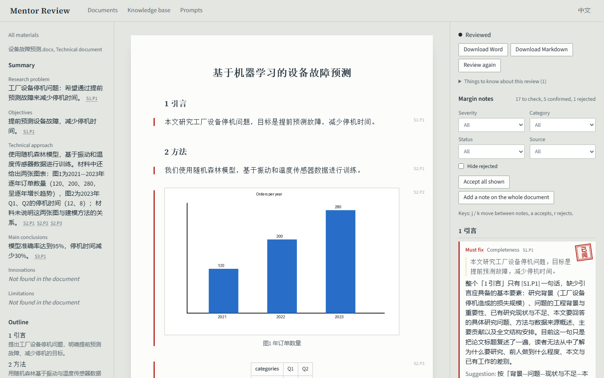

# Industry Mentor Review Assistant · 行业导师大模型智能体

A review assistant for industry mentors of professional master's students. The mentor uploads a
student's practice report, project proposal or technical document; the assistant

1. **summarises it** — research problem, objectives, technical approach, conclusions, innovations,
   limitations — and links every point to the paragraphs it came from;
2. **checks it against the mentor's own standards** — review rubrics, training-programme
   requirements and exemplary past work, stored in a knowledge base (RAG) — plus rule-based format
   checks (heading numbering, citations, figure captions, required sections);
3. **drafts margin notes on specific paragraphs**, each with the problem, a suggestion and revision
   steps. The mentor accepts, edits, rejects or adds notes, then downloads the feedback as Word
   (comments inside the student's own .docx) or Markdown.

Figures are read too: charts, diagrams and screenshots go to a vision model, and native Word charts
are read from their data. Every prompt the assistant uses can be edited in the app.



Built with **LangChain** (structured output, retrieval), **FastAPI**, **Chroma**, **SQLite** and a
**React + TypeScript** interface.

## Setup

Needs Python 3.11+ with [uv](https://docs.astral.sh/uv/), and Node 20+.

```bash
cd backend && uv sync && cp .env.example .env   # then put your model settings in .env
uv run uvicorn app.main:app --port 8000          # API on http://127.0.0.1:8000 (docs at /docs)
cd ../frontend && npm install && npm run dev      # open http://localhost:5173
```

### Choosing a model (`backend/.env`)

| Provider | Settings |
|---|---|
| DeepSeek | `LLM_BASE_URL=https://api.deepseek.com` `LLM_MODEL=deepseek-chat` `LLM_API_KEY=…` |
| Qwen (DashScope) | `LLM_BASE_URL=https://dashscope.aliyuncs.com/compatible-mode/v1` `LLM_MODEL=qwen-plus` · vision `VISION_MODEL=qwen-vl-max` · embeddings `EMBEDDING_MODEL=text-embedding-v3` with the same URL and key |
| Ollama (local or Ollama Cloud) | `LLM_BASE_URL=http://localhost:11434/v1` (or `https://ollama.com/v1`) `LLM_MODEL=qwen2.5:14b` `LLM_API_KEY=ollama` · vision `VISION_MODEL=qwen2.5vl` |
| OpenRouter / Groq | `LLM_PROVIDER=openrouter` or `groq` (URL is filled in) · `LLM_MODEL=…` `LLM_API_KEY=…` |
| Claude | `LLM_PROVIDER=anthropic` `LLM_MODEL=claude-sonnet-5-5` `LLM_API_KEY=…` |

**Knowledge base embeddings** are separate (`EMBEDDING_*`), because OpenRouter, Groq and Anthropic
have no embeddings API. For a fully local setup use Ollama: `ollama pull bge-m3`, then
`EMBEDDING_MODEL=bge-m3`, `EMBEDDING_BASE_URL=http://localhost:11434/v1`, `EMBEDDING_API_KEY=ollama`.
Leave both `EMBEDDING_BASE_URL` and `EMBEDDING_API_KEY` empty to review without a knowledge base.

To load a folder at once: `uv run python -m app.kb seed <folder>`. The file name picks the kind:
`program`/`培养` → programme requirement, `exemplar`/`范例` → exemplar, anything else → standard.

## How a review runs

```
upload → parse (sections, paragraphs S3.P2, figures) → figures described by the vision model
       → structured summary (one call, or map-reduce for long documents)
       → rule-based format checks
       → each section: retrieve standards / requirements / exemplars → model drafts notes
       → every note's paragraph and quote checked against the real text → duplicates merged
mentor: accept · edit · reject · add  →  overall feedback  →  Word / Markdown
```

Student text is wrapped as data and the model is told to ignore instructions inside it; output
format is enforced in code, so editing a prompt can't break a review.

## Tests

```bash
cd backend && uv run pytest -q                        # 300+ tests, no model calls
RUN_LIVE=1 uv run pytest -m live                      # a few real-model smoke tests
cd frontend && npm run test -- --run && npm run lint
npx playwright install chromium && npx playwright test  # browser smoke test, uses LLM_PROVIDER=fake
```

## Limitations

- Single user, no login; the server listens on 127.0.0.1 only.
- Scanned PDFs (images without a text layer) are refused; run OCR first.
- In the Word export, notes are placed by matching text, so a file edited after upload may get a
  note on a neighbouring paragraph; anything that can't be placed goes under "General comments".
- Reviews run inside the server process; restarting it marks running reviews as failed (retry them).
- Everything lives in `backend/data/` (database, uploads, vector index). Deleting that folder
  resets the app.

## Three-minute demo

1. **Upload** a proposal (.docx with a chart) on *Student materials*, choose *Project proposal*.
2. **Start review.** Point out the progress stages, then the summary on the left: each point links
   to the paragraph it came from; missing items say *Not found* instead of being invented.
3. **Margin notes.** Click a note: the page scrolls to the paragraph and highlights the quote.
   Accept one (the 已阅 seal), edit one in your own words, reject one, press `j`/`a` to show the
   keyboard flow. Select a sentence in the document and add your own note.
4. **Open the chart** to show what the vision model read from it.
5. **Prompts:** open *Section review*, add a line such as "At most 5 notes per section", save it
   as a new version; remove `{section}` to show the editor refusing a broken prompt.
6. **Review again** to show the prompt change take effect.
7. **Overall feedback:** draft it from the confirmed notes, adjust a sentence, save.
8. **Download Word** and open it: the comments sit on the student's own paragraphs.
