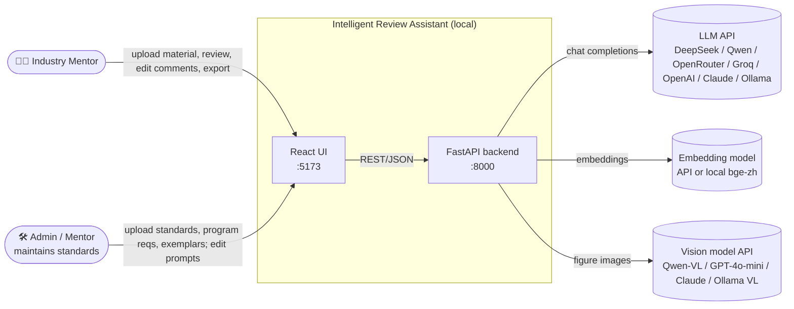
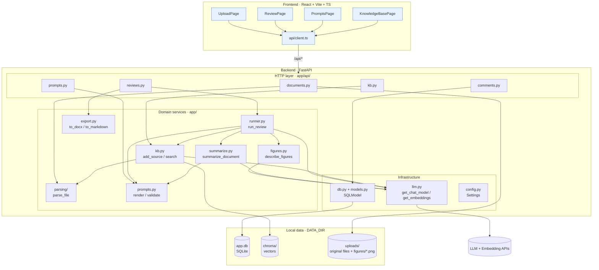
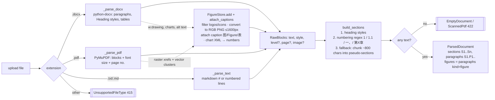
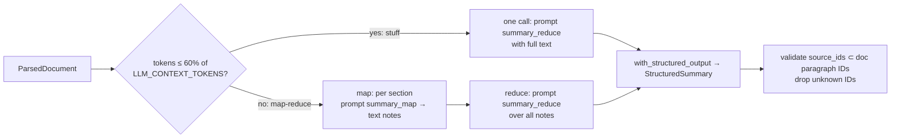
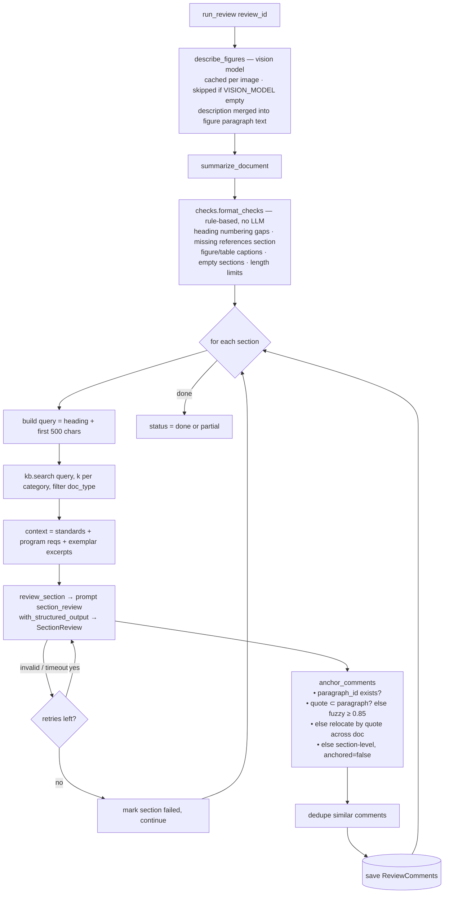
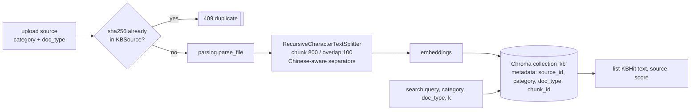
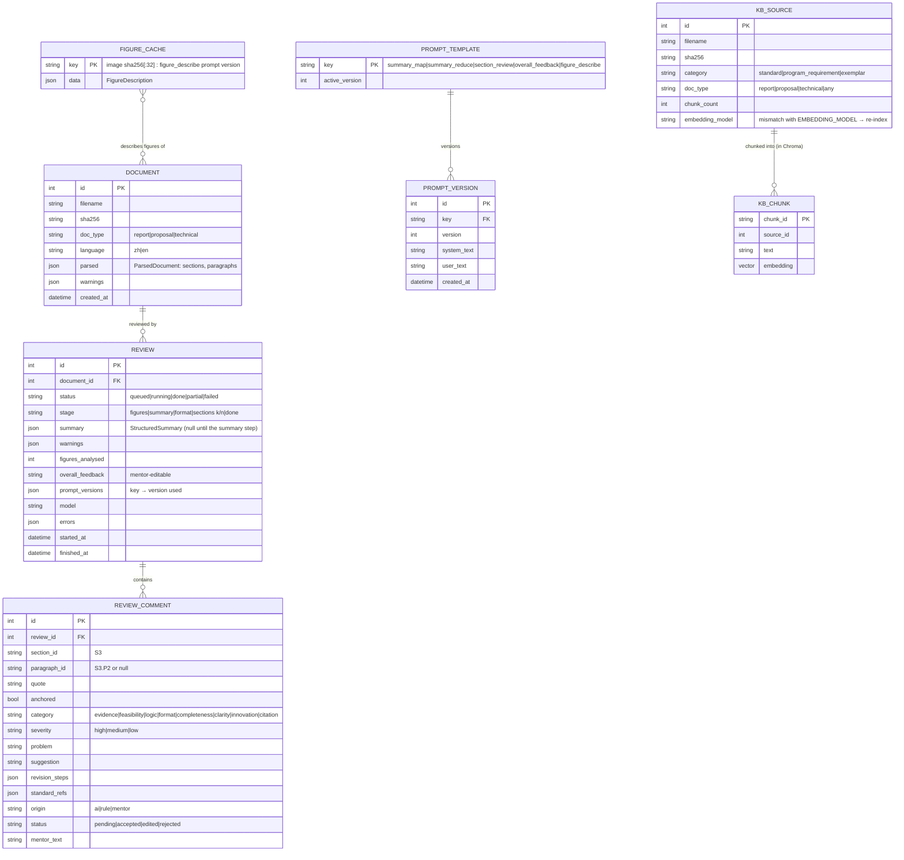
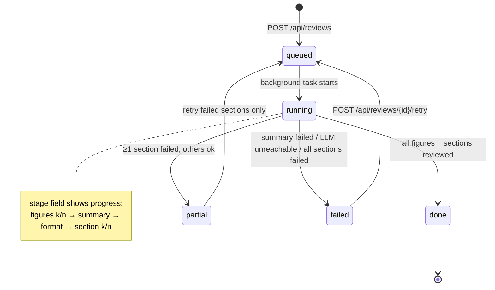
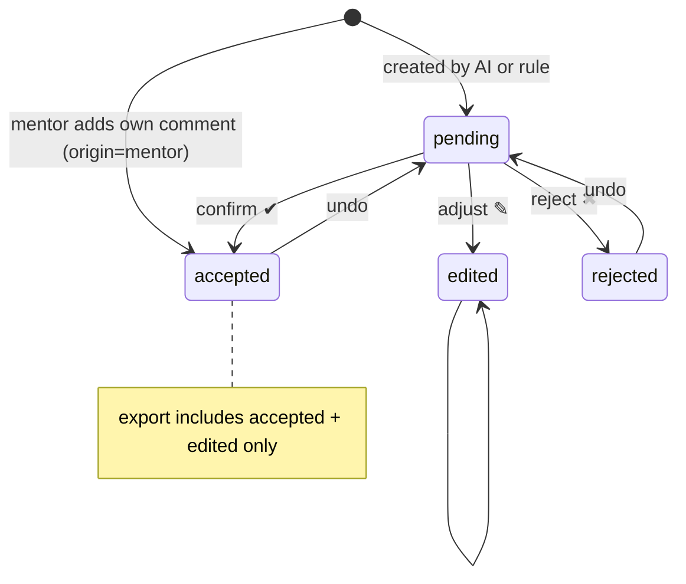

# Architecture — Industry Mentor LLM Agent

> **How to use the diagrams:** they are [Mermaid](https://mermaid.js.org). In **VS Code** (built-in Markdown preview + the *Markdown Preview Mermaid Support* extension) or **Obsidian**, nodes are **clickable** and open the source file. On GitHub, diagrams render but click-links are disabled; use the file table under each diagram instead. Each `▶ Details` block expands to show one component's internals.

---

## 1. System context

---

## 2. Container / layer view

| Layer | Rule |
|---|---|
| `app/api/*` | Thin: validate input, call one service, map errors to HTTP. No LLM calls here. |
| Domain services | Pure-ish functions; take a chat model / store as an argument (or default from `llm.py`) so tests inject fakes. |
| `llm.py` | The **only** place that constructs LangChain chat/embedding models. Retries, timeouts, provider switch live here. |
| `prompts.py` | The **only** source of prompt text. Defaults in code, overrides in DB. |

▶ Details: <code>parsing/</code> — document parser & sectionizer

▶ Details: <code>summarize.py</code> — structured summary

▶ Details: <code>review.py</code> — RAG review engine (features 2 + 3)

▶ Details: <code>kb.py</code> — knowledge base

---

## 3. Data model

`ParsedDocument` is stored as JSON in `DOCUMENT.parsed` — it's read whole and never queried by field, so a table per paragraph would be overhead.

---

## 4. Review lifecycle (state machine)

Comment lifecycle (mentor side):

---

## 5. REST API

| Method | Path | Purpose | Main errors |
|---|---|---|---|
| POST | `/api/documents` | multipart upload → parse → store | 413 too large · 415 type · 422 empty/scanned/encrypted |
| GET | `/api/documents` · `/api/documents/{id}` | list / get with parsed sections | 404 |
| DELETE | `/api/documents/{id}` | delete doc + reviews + figure files | 404 |
| GET | `/api/documents/{id}/figures/{image_id}` | figure PNG for the viewer | 404 |
| POST | `/api/reviews` `{document_id}` | create review, start background run | 404 doc · 503 LLM not configured |
| GET | `/api/reviews/{id}` | status, stage, summary, comments | 404 |
| POST | `/api/reviews/{id}/retry` | re-run failed parts | 409 if running |
| GET | `/api/reviews/{id}/export?format=docx\|md` | final feedback file (accepted + edited + mentor comments) | 409 while running · 422 bad format |
| POST · PUT | `/api/reviews/{id}/overall` | generate overall feedback from confirmed comments · save mentor's text | 409 none confirmed / running · 502 LLM failed |
| PATCH | `/api/comments/{id}` | status / mentor_text / severity / category | 404 · 422 (`EMPTY_EDIT`) |
| POST | `/api/reviews/{id}/comments` | mentor adds comment (paragraph, section or whole document) | 422 `BAD_ANCHOR` · `BAD_QUOTE` |
| POST | `/api/reviews/{id}/comments/bulk` `{ids, status}` | e.g. accept all high-severity | 422 `UNKNOWN_COMMENTS` |
| DELETE | `/api/comments/{id}` | delete a mentor comment | 403 for AI/rule comments (reject instead) |
| GET | `/api/prompts` · PUT `/api/prompts/{key}` · POST `/api/prompts/{key}/reset` | prompt management | 422 invalid template |
| GET | `/api/prompts/{key}/versions` | history | |
| POST/GET/DELETE | `/api/kb/sources` | knowledge base | 409 duplicate · 415 · 422 |
| GET | `/api/kb/search?q=&category=` | debug: test retrieval | |
| GET | `/api/health` | liveness + LLM configured? | |

---

## 6. Cross-cutting concerns

| Concern | Decision |
|---|---|
| **Long-running work** | FastAPI `BackgroundTasks`; UI polls `GET /api/reviews/{id}` every 2 s. `# ponytail: in-process tasks die with the server; move to a job queue if multi-user.` On startup, reviews stuck in `running` are marked `failed` ("server restarted"). |
| **Concurrency** | Sections reviewed with bounded concurrency (`asyncio.Semaphore(3)`) to respect rate limits. |
| **Providers** | `llm.py` builds everything: OpenAI-compatible client for `openai_compatible`/`openrouter`/`groq` (preset URLs), `ChatAnthropic` for `anthropic`. Vision model reuses the LLM connection unless `VISION_*` overrides it. |
| **LLM failures** | `max_retries` + timeout in `llm.py`; structured-output parse errors retried once with the error appended; then section marked failed. |
| **Prompt injection** | Student text in `<document>` tags; system prompt says content inside is data. Output schema enforced in code. |
| **Images** | Extracted at parse time (no LLM), described at review time by a separate vision model; unsupported formats kept with `analysable=false` so nothing disappears silently. |
| **Hallucinated anchors** | `anchor_comments` validates every ID/quote against the parsed doc. |
| **Hallucinated summary** | `not_found` flag per field; `source_ids` validated. |
| **Reproducibility** | Each review stores the prompt version + model used. |
| **Language** | `OUTPUT_LANGUAGE=auto` → detect from doc (CJK ratio) → `{language}` variable in every prompt. |
| **Security** | Uploads stored under random UUID names (no path traversal), size-limited, extension + magic-byte checked. API binds to `127.0.0.1` by default. CORS limited to the Vite origin. |
| **Privacy** | Student material is sent to the configured LLM provider; README notes this; Ollama option for fully local use. |
